# TP2 REST : Service web « Calculatrice » avec JAX-RS et Tomcat

**Matière** : Architecture MicroServices, MPSRCC1
**Faculté des Sciences de Sfax**, Département d'informatique et des Communications, année universitaire 2026-2027
**Enseignantes** : Corinne Amel ZAYANI, Amal ABID
**Auteure** : Nour Chtourou

## Sommaire
1. [Présentation et environnement](#1-présentation-et-environnement)
2. [Partie A : Conception](#2-partie-a--conception)
3. [Partie B : Projet Maven](#3-partie-b--projet-maven)
4. [Partie C : Service somme](#4-partie-c--service-somme)
5. [Partie D : Calculatrice complète](#5-partie-d--calculatrice-complète)
6. [Partie E : JSON](#6-partie-e--json)
7. [Partie F : Ressource operations](#7-partie-f--ressource-operations)
8. [Questions de synthèse](#8-questions-de-synthèse)

---

## 1. Présentation et environnement

Service web REST exposant une calculatrice (somme, soustraction, produit, division) et un historique d'opérations (création, lecture, modification, suppression), développé avec JAX-RS (Jersey) et déployé dans Tomcat.

| Élément | Version / valeur |
|---|---|
| JDK | 17+ (compilation avec `<release>17</release>`) |
| Apache Tomcat | 10.1.61 (Jakarta EE 10) |
| Jersey | 3.1.9 |
| Maven | wrapper inclus (`mvnw.cmd`) |
| IDE | IntelliJ IDEA |
| Outils de test | navigateur, curl, Postman, client HTTP d'IntelliJ (`calcul.http`) |

### Construire et lancer
```
.\mvnw.cmd clean package
```
Produit `target/RestWebApp.war`. Le déploiement se fait depuis IntelliJ (artefact `RestWebApp:war exploded`, contexte `/RestWebApp`).

**URL de base** : `http://localhost:8080/RestWebApp/api`

### Structure du projet
```
TP2_arch/
├── captures/                 captures d'écran du compte rendu
├── calcul.http               requêtes de test (client HTTP d'IntelliJ)
├── pom.xml
├── README.md
└── src/main/java/com/exemple/rest/
    ├── Calculatrice.java     logique métier
    ├── RestApplication.java  activation de JAX-RS (@ApplicationPath("/api"))
    ├── CalculRest.java       ressource /calcul
    ├── Resultat.java         objet renvoyé en JSON
    ├── Operation.java        objet de l'historique
    └── OperationRest.java    ressource /operations
```

### Problèmes rencontrés et corrections
| Problème | Cause | Solution |
|---|---|---|
| `Connection reset` pendant la synchronisation Maven | Coupure réseau pendant le téléchargement des dépendances | Nouvelle tentative de rechargement |
| 404 sur toutes les URI `/api/...` | `pom.xml` du modèle IntelliJ : `jersey-hk2` absent, donc Jersey ne démarre pas | Remplacement par le `pom.xml` du TP |
| `webxml attribute is required` au build | Aucun `web.xml` dans le projet | Ajout de `<failOnMissingWebXml>false</failOnMissingWebXml>` dans `maven-war-plugin` |
| `curl: (3) unmatched close brace` en PowerShell | PowerShell altère les guillemets doubles échappés du JSON | JSON entouré de guillemets simples : `-d '{\"operateur\":\"somme\",\"a\":8,\"b\":2}'` |

---

## 2. Partie A : Conception

1. **Pourquoi GET et non POST pour les calculs directs ?**
   Un calcul direct ne crée ni ne modifie aucune donnée sur le serveur : il demande seulement un résultat. GET est le verbe prévu pour la lecture, il est sûr (sans effet de bord) et idempotent.

2. **Comment s'appelle la partie située après le `?` dans `/calcul/somme?a=2&b=3` ?**
   La chaîne de requête (*query string*), qui contient les paramètres de requête (`a=2` et `b=3`).

3. **Différence entre `/operations` et `/operations/3` ?**
   `/operations` désigne la collection de toutes les opérations ; `/operations/3` désigne une seule ressource de cette collection, l'opération d'identifiant 3.

4. **Statut HTTP si `/operations/99` n'existe pas ?**
   **404 (Not Found)**.

---

## 3. Partie B : Projet Maven

- Projet web Maven (`<packaging>war</packaging>`) créé avec le générateur Jakarta EE d'IntelliJ.
- Dépendances : `jakarta.ws.rs-api` 3.1.0, `jersey-container-servlet` (intégration à Tomcat), `jersey-hk2` (moteur d'injection indispensable), `jersey-media-json-binding` (conversion objet Java ↔ JSON), Jersey en version 3.1.9.
- `<finalName>RestWebApp</finalName>` fixe le nom du fichier `RestWebApp.war`, donc le contexte `/RestWebApp` dans l'URL.
- Aucun `web.xml` : l'annotation `@ApplicationPath("/api")` active JAX-RS.

---

## 4. Partie C : Service somme

Requête : `GET /RestWebApp/api/calcul/somme?a=2&b=3`
Résultat : statut **200**, en-tête `Content-Type: text/plain`, corps **5**.

| Outil | Capture |
|---|---|
| Navigateur | 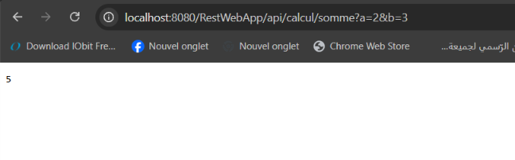 |
| IntelliJ (`calcul.http`) | 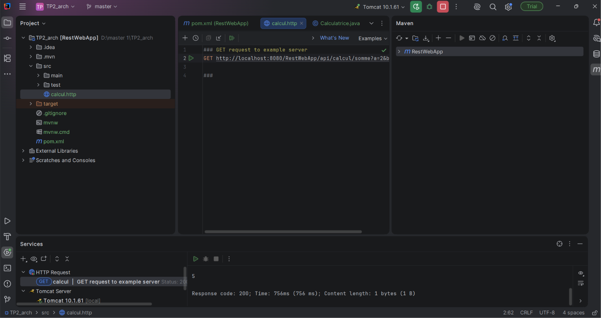 |
| Postman | 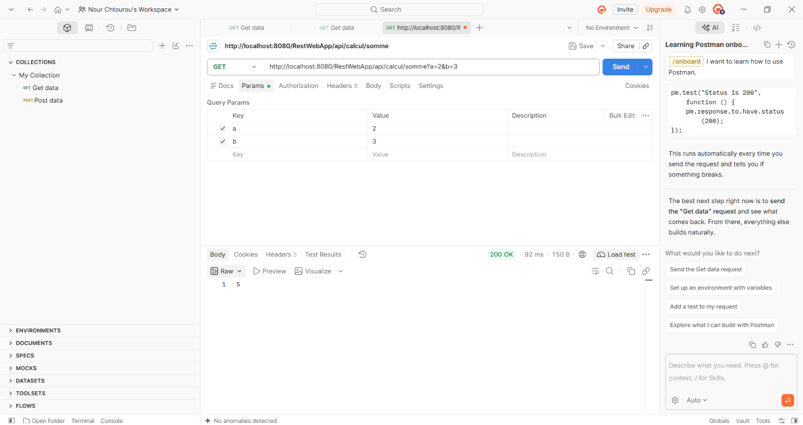 |
| curl `-i` | 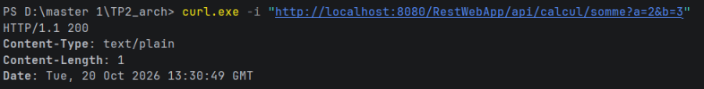 |

### Décomposition de l'URL
| Partie | Origine |
|---|---|
| `localhost:8080` | Machine locale et port par défaut de Tomcat |
| `/RestWebApp` | Nom du `.war` (`<finalName>` du `pom.xml`) |
| `/api` | `@ApplicationPath("/api")` |
| `/calcul` | `@Path("/calcul")` sur la classe |
| `/somme` | `@Path("/somme")` sur la méthode |
| `?a=2&b=3` | Paramètres lus par `@QueryParam` |

### Question C.1 : même URL avec POST
- **Statut obtenu** : **405 Method Not Allowed** (page HTML « État HTTP 405 – Méthode non autorisée » renvoyée par Tomcat).
- **Explication** : la méthode `somme` est annotée uniquement `@GET`. L'URI existe, mais aucune méthode n'y répond au verbe POST ; le serveur refuse donc le verbe.

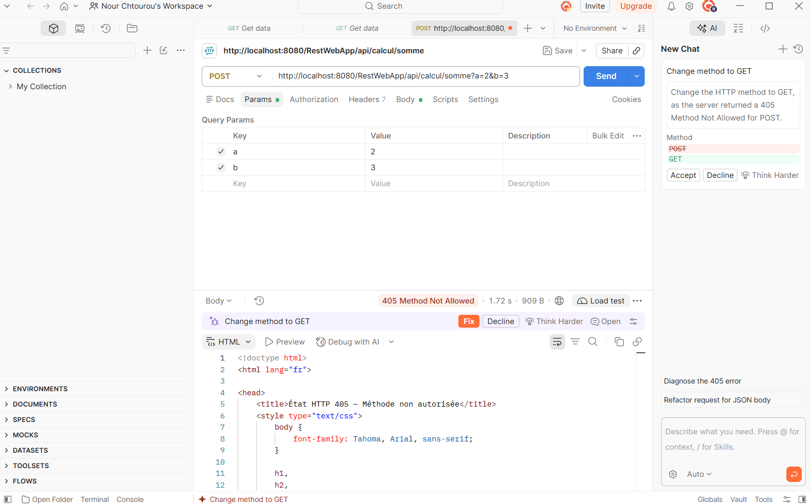

---

## 5. Partie D : Calculatrice complète

Les requêtes de test sont regroupées dans `calcul.http` :

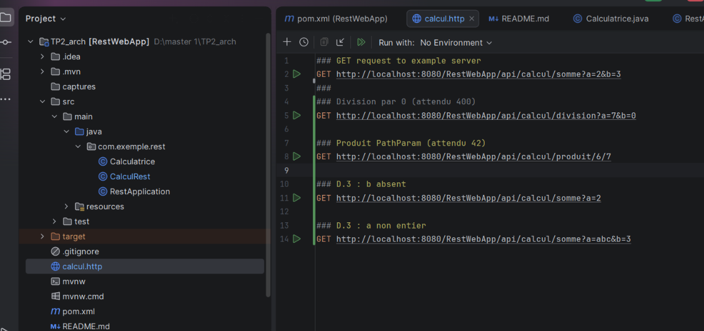

### D.1 et D.2 : soustraction, produit, division
| Requête | Statut | Corps | Capture |
|---|---|---|---|
| `GET /calcul/soustraction?a=10&b=4` | 200 | `6` | 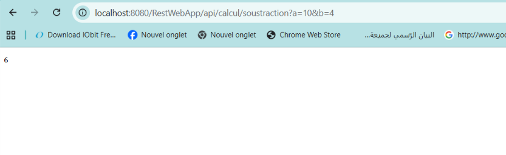 |
| `GET /calcul/produit?a=6&b=7` | 200 | `42` | 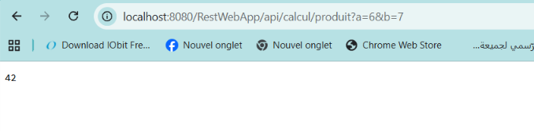 |
| `GET /calcul/division?a=7&b=2` | 200 | `3.5` | 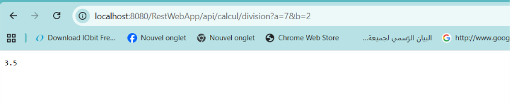 |
| `GET /calcul/division?a=7&b=0` | **400** | `Erreur : division par 0 impossible` | 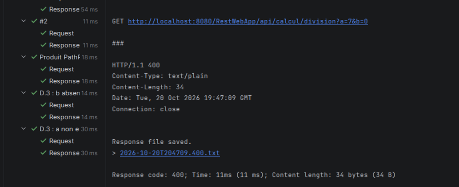 |

La division par zéro est une erreur du client : le service répond 400 (Bad Request) avec un message explicite, et non un résultat faux ou une erreur interne 500. Message vu dans le navigateur :

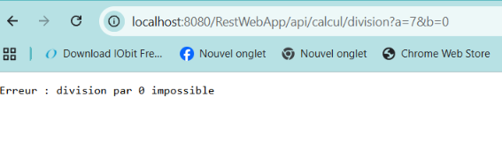

### D.3 : observations sur les paramètres
| Requête | Statut | Corps | Capture |
|---|---|---|---|
| `GET /calcul/somme?a=2` (b absent) | **200** | `2` | 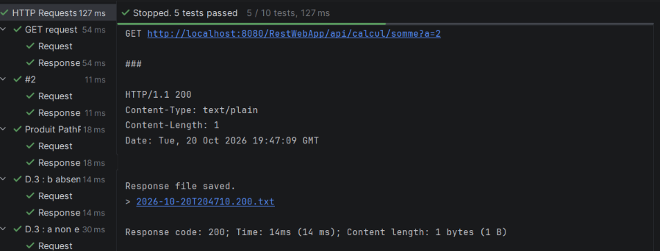 |
| `GET /calcul/somme?a=abc&b=3` | **404** | Page d'erreur HTML de Tomcat | 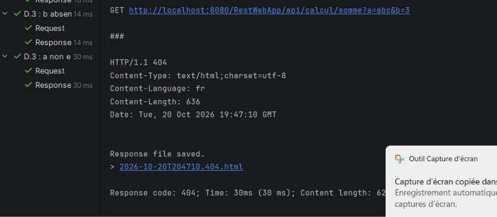 |

Vérification du corps avec curl (`b` absent, le résultat vaut bien 2) :

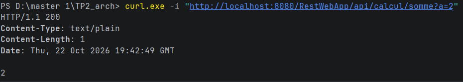

- **Question D.1 : quelle valeur JAX-RS donne-t-il à un paramètre entier absent ?**
  La valeur par défaut du type, **0** pour un `int`. Ici `b` vaut 0, le service calcule 2 + 0 = 2 et répond 200 sans erreur.
- **Question D.2 : quel statut quand le paramètre n'est pas un entier ? `somme` a-t-elle été exécutée ?**
  Statut **404**. La conversion de `abc` en entier échoue avant l'appel de la méthode (la spécification JAX-RS prévoit une réponse 404 quand un `@QueryParam` ne peut pas être converti). La méthode `somme` **n'a donc pas été exécutée**.

### D.4 : `@PathParam`
| Requête | Statut | Corps | Capture |
|---|---|---|---|
| `GET /calcul/produit/6/7` | 200 | `42` | 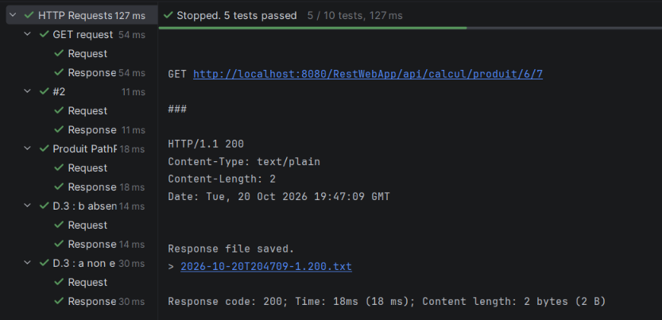 |

- **Question D.3 : différence entre `@QueryParam` et `@PathParam` ? Laquelle pour `/operations/{id}` ?**
  `@QueryParam` lit un paramètre placé après le `?` dans l'URI (`?a=6&b=7`). `@PathParam` lit une valeur située dans le chemin lui-même (`/produit/6/7`). Pour lire l'identifiant dans `/operations/{id}`, on utilise **`@PathParam`**.

---

## 6. Partie E : JSON

La classe `Resultat` (constructeur sans argument, getters et setters publics) est convertie automatiquement en JSON par Jersey.

### E.2 : méthode `sommeDetail`
| Requête | Statut | Content-Type | Corps | Capture |
|---|---|---|---|---|
| `GET /calcul/somme/detail?a=2&b=3` | **200** | `application/json` | `{"a":2,"b":3,"operation":"somme","resultat":5.0}` | 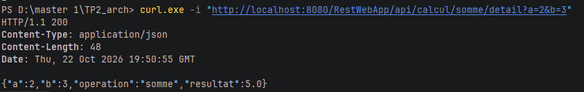 |

### E.3 : en-tête `Accept`
| Requête | Statut | Content-Type | Capture |
|---|---|---|---|
| `Accept: application/json` | **200** | `application/json` | 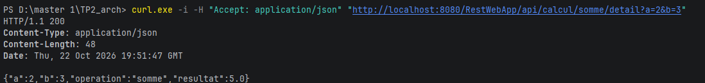 |
| `Accept: application/xml` | **406** | `text/html` (page d'erreur Tomcat « Inacceptable ») | 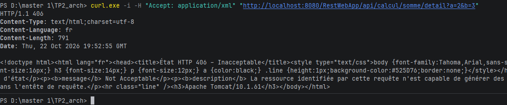 |

### Questions
- **Question E.1 : qui a effectué la conversion en JSON ? D'où viennent les noms `a`, `b`, `operation`, `resultat` ?**
  La conversion est faite automatiquement par Jersey, grâce à la dépendance `jersey-media-json-binding`. Les noms des champs viennent des **accesseurs** (`getA()`, `getB()`, `getOperation()`, `getResultat()`) de la classe `Resultat`, d'où la nécessité d'un constructeur sans argument et de getters/setters publics.
- **Question E.2 : pourquoi la requête avec `Accept: application/xml` est-elle refusée ?**
  La méthode est annotée `@Produces(MediaType.APPLICATION_JSON)` : elle ne sait produire que du JSON. Le client demande du XML, que le serveur ne peut pas fournir, d'où le statut **406 (Not Acceptable)** observé.

### E.4 : exercice `divisionDetail`
`GET /calcul/division/detail?a=..&b=..` renvoie un `Resultat` en JSON, et le statut 400 si `b` vaut 0.

| Requête | Statut | Corps | Capture |
|---|---|---|---|
| `GET /calcul/division/detail?a=7&b=2` | **200** | `{"a":7,"b":2,"operation":"division","resultat":3.5}` | 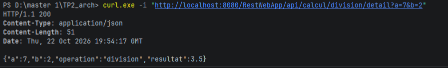 |
| `GET /calcul/division/detail?a=7&b=0` | **400** | `{"erreur":"Division par 0 impossible"}` | 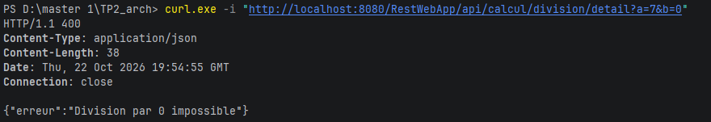 |

---

## 7. Partie F : Ressource « operations »

Les opérations sont conservées **en mémoire** (`ConcurrentHashMap`), sans base de données : elles sont perdues à chaque redémarrage ou redéploiement de Tomcat, et la numérotation repart de 1. Les attributs sont `static` car JAX-RS crée un nouvel objet `OperationRest` pour chaque requête ; `ConcurrentHashMap` et `AtomicInteger` gèrent les accès simultanés.

Tests réalisés avec `curl.exe -i` (PowerShell). Pour les 404, le code renvoie `Response.status(NOT_FOUND)` sans corps : c'est Tomcat qui génère la page d'erreur HTML visible dans les captures.

### F.3 : création et lecture
| N° | Requête | Corps envoyé | Statut | Corps obtenu | Capture |
|---|---|---|---|---|---|
| 1 | `POST /operations` | `{"operateur":"somme","a":8,"b":2}` | **201** | `{"a":8,"b":2,"id":1,"operateur":"somme","resultat":10.0}` + en-tête `Location: .../operations/1` | 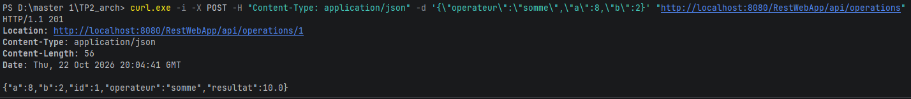 |
| 2 | `POST /operations` | `{"operateur":"division","a":7,"b":2}` | **201** | `{"a":7,"b":2,"id":2,"operateur":"division","resultat":3.5}` + `Location: .../operations/2` | 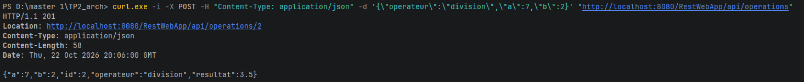 |
| 3 | `GET /operations` | aucun | **200** | tableau JSON des opérations 1 et 2 | 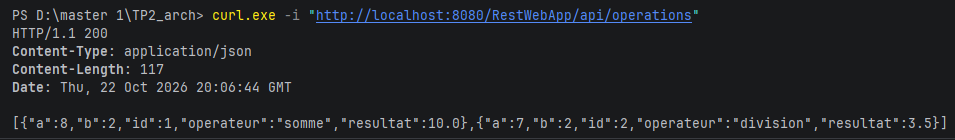 |
| 4 | `GET /operations/2` | aucun | **200** | l'opération 2 | 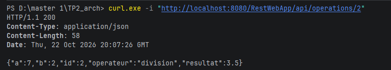 |
| 5 | `GET /operations/99` | aucun | **404** | page HTML d'erreur Tomcat | 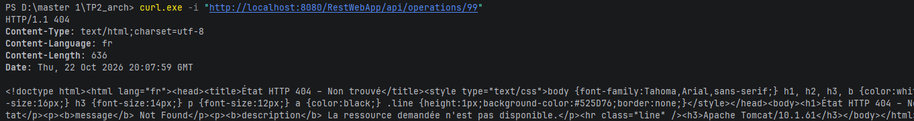 |
| 6 | `POST /operations` | `{"operateur":"division","a":7,"b":0}` | **400** | `{"erreur":"Calcul impossible"}` | 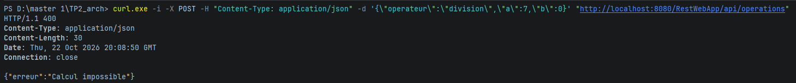 |
| 7 | `POST /operations` | `{"operateur":"racine","a":9,"b":0}` | **400** | `{"erreur":"Calcul impossible"}` | 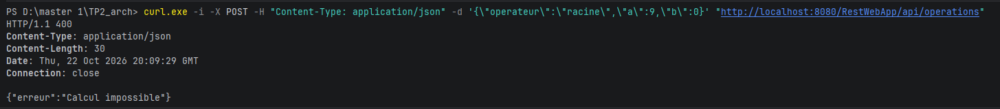 |

### F.4 : modification (PUT)
| Requête | Corps envoyé | Statut | Corps obtenu | Capture |
|---|---|---|---|---|
| `PUT /operations/1` | `{"operateur":"produit","a":8,"b":2}` | **200** | `{"a":8,"b":2,"id":1,"operateur":"produit","resultat":16.0}` | 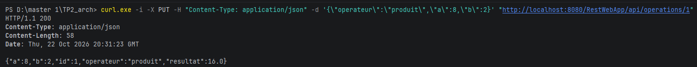 |
| `GET /operations/1` (vérification) | aucun | **200** | opération 1 : `produit`, résultat 16.0 | 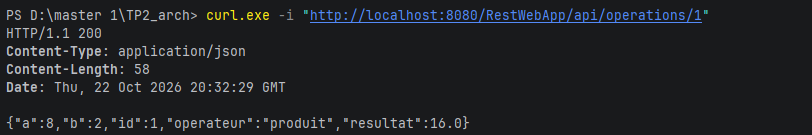 |
| `PUT /operations/99` | `{"operateur":"somme","a":1,"b":1}` | **404** | page HTML d'erreur Tomcat | 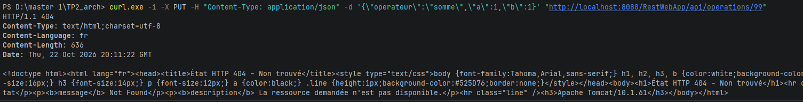 |
| `PUT /operations/1` | `{"operateur":"division","a":1,"b":0}` | **400** | `{"erreur":"Calcul impossible"}` | 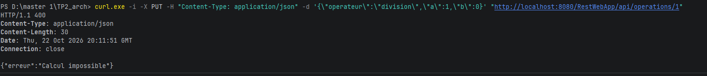 |

### F.5 : suppression (DELETE)
| Requête | Statut | Corps obtenu | Capture |
|---|---|---|---|
| `DELETE /operations/1` | **204** | vide | 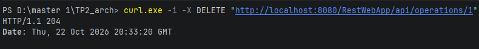 |
| `GET /operations/1` | **404** | page HTML d'erreur Tomcat | 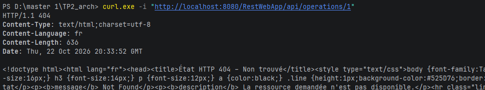 |
| `DELETE /operations/1` | **404** | page HTML d'erreur Tomcat | 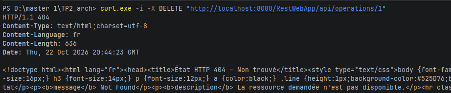 |

---

## 8. Questions de synthèse

### 1. Tableau de l'étape A.1 avec les codes de statut
| Verbe | URI | Rôle | Statuts observés |
|---|---|---|---|
| GET | `/calcul/somme?a=&b=` | a + b | 200 ; 404 si un paramètre n'est pas un entier |
| GET | `/calcul/soustraction?a=&b=` | a − b | 200 ; 404 si un paramètre n'est pas un entier |
| GET | `/calcul/produit?a=&b=` | a × b | 200 ; 404 si un paramètre n'est pas un entier |
| GET | `/calcul/division?a=&b=` | a ÷ b | 200 ; 400 si b = 0 ; 404 si un paramètre n'est pas un entier |
| POST | `/operations` | Crée une opération | 201 ; 400 si calcul impossible |
| GET | `/operations` | Liste les opérations | 200 |
| GET | `/operations/{id}` | Lit l'opération id | 200 ; 404 si inexistante |
| PUT | `/operations/{id}` | Modifie l'opération id | 200 ; 400 si calcul impossible ; 404 si inexistante |
| DELETE | `/operations/{id}` | Supprime l'opération id | 204 ; 404 si inexistante |

Le statut 405 (verbe non autorisé, observé en C.1) et le statut 406 (format `Accept` non supporté, observé en E.3) peuvent aussi apparaître.

### 2. Annotations JAX-RS utilisées
| Annotation | Rôle |
|---|---|
| `@ApplicationPath` | Définit le préfixe commun de toutes les URI du service (`/api`) et active JAX-RS |
| `@Path` | Associe une classe ou une méthode à un chemin d'URI |
| `@GET` | La méthode répond aux requêtes HTTP GET |
| `@POST` | La méthode répond aux requêtes HTTP POST (création) |
| `@PUT` | La méthode répond aux requêtes HTTP PUT (modification) |
| `@DELETE` | La méthode répond aux requêtes HTTP DELETE (suppression) |
| `@Produces` | Indique le type de contenu renvoyé (`text/plain`, `application/json`) |
| `@Consumes` | Indique le type de contenu attendu dans le corps de la requête |
| `@QueryParam` | Lit un paramètre de requête situé après le `?` |
| `@PathParam` | Lit une valeur située dans le chemin de l'URI |
| `@Context` | Injecte un objet du contexte, ici `UriInfo` pour construire l'en-tête `Location` |

### 3. Différence entre JAX-RS et Jersey
**JAX-RS** (Jakarta RESTful Web Services) est une **spécification** : elle définit l'API et les annotations (`@Path`, `@GET`...), sans code exécutable. **Jersey** en est l'**implémentation** de référence : c'est lui qui lit les annotations, route les requêtes et convertit les objets en JSON.

### 4. Rôle de Tomcat ; pourquoi un `.war` et non un `.jar` exécutable ?
Tomcat est un **conteneur de servlets** : il écoute le port 8080, reçoit les requêtes HTTP, les transmet à l'application (la servlet Jersey) et renvoie la réponse. Le projet produit un `.war` car c'est le format d'une application web **déployée dans un serveur existant** : le serveur est fourni par Tomcat, l'application n'a pas à l'embarquer. Un `.jar` exécutable doit contenir son propre serveur (approche de Spring Boot) et se lance seul.

### 5. Principe stateless et liste des opérations
Le principe stateless interdit au serveur de mémoriser l'**état de la conversation avec le client** (session, contexte entre deux requêtes) : chaque requête contient tout ce qu'il faut pour être traitée. La liste des opérations n'est pas un état de session mais l'**état de la ressource** : elle est partagée par tous les clients et ne dépend d'aucun d'eux. Par exemple, `GET /operations/2` se comprend sans connaître les requêtes précédentes.

### 6. Répétition de POST et de PUT
- **POST `/operations` envoyé deux fois** : chaque envoi **crée une nouvelle opération**, car le serveur attribue un nouvel identifiant à chaque appel (`COMPTEUR.incrementAndGet()`). Nos deux POST de F.3 (n° 1 et 2) ont ainsi créé les id 1 et 2. POST n'est **pas idempotent**.
- **PUT `/operations/1` envoyé deux fois** : la seconde requête remplace l'opération 1 par les mêmes valeurs (`OPERATIONS.put(id, op)` avec le même `id`) ; l'état final est identique à celui obtenu après la première. PUT est **idempotent**.

---

## Dépôt Git
Le projet Maven complet, ce README, `calcul.http` et le dossier `captures/` sont versionnés dans ce dépôt.